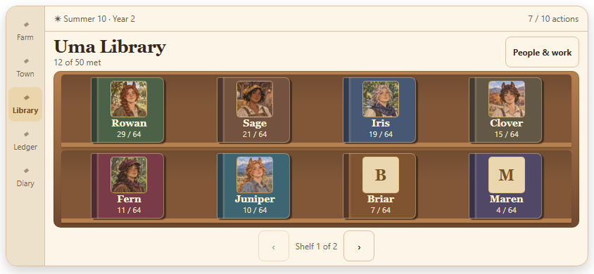
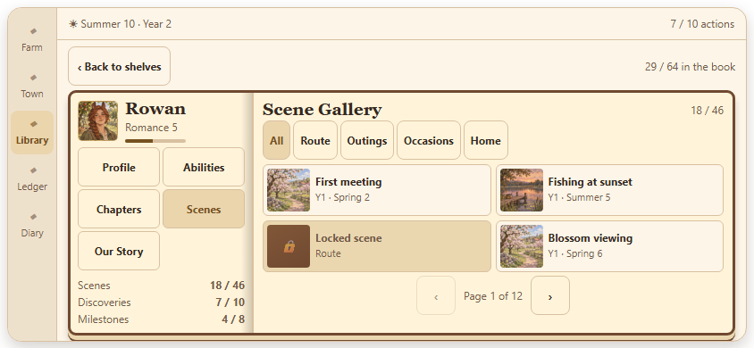
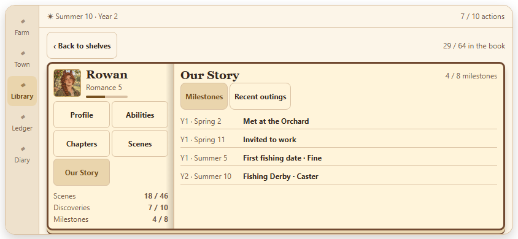

# F101 · Uma Library

**Status · Authored**

The People tab opens a bookshelf of the Umas the farmer has met. Each book uses her small profile portrait on
the cover. Inside are her profile and abilities, relationship chapters, a gallery of the scenes the player
has unlocked, and a dated record of their life together. Playing the farm fills the book. Reading it is free.

[Compact landscape mockup at 667×375](F101-mockups/compact-book.png)

## Decisions in this packet

- **Library on the People rail.** Give the shelf the People slot and label it **Library**. A book goes on the
  shelf when the farmer meets her. Keep one book per saved character ID, including each sister with her own ID.
- **The Farm Book is the ledger.** Label its rail slot **Farm Book** where it fits and **Ledger** at compact widths.
  It holds finances, upkeep, meals, stock shortcuts and work orders. The new collection has its own entry point.
- **Farm achievements live in the Diary.** Farm Rank, shipping collections, builds, farm milestones, festival
  placements and household-wide achievements stay discoverable there. An Uma’s book shows personal contributions
  the save can prove and links to the source result. A prize or milestone pays through its existing rule once.
- **Finish a book through play.** Scenes, discovered facts and distinct relationship milestones each fill a slot.
  Repeated dates add history and can improve a best. Workshop ranks and aptitudes have their own progress bars.
- **An original farm scrapbook.** Cloth covers, portrait insets, wooden shelves and paper spreads frame the game’s
  existing small profile art. The mockups use an invented cast and scenes.

## Navigation and layout

### The bookshelf

Show the number met out of the current playable cast, then face-out books in the cast’s shelf order. Keep any
already-met Uma whose role or pack entry changes on the shelf. Order her after the current cast if her old slot
is unavailable. An empty shelf reads **Meet someone in town** with a Town link. Unmet Umas contribute to the cast
count. There is room for their books as the farmer meets them.

A cover has her current profile picture, name and a single ring or ribbon for book progress. Use the existing
face resolver and its silhouette and initials when a picture is missing or offline. The cover itself is the hit
target. Show two shelves of four covers at 844×390 and two of three at 667×375 as layout targets, with 44 pt
navigation controls. Size from usable width after the rail and safe areas. With 50 met, the usual page counts
are seven and nine respectively. The pager and touch gesture change the same shelf. Anchor the shelf to the
selected Uma on Back and recompute her page after a width change or a cast update.

The default shelf order stays stable when a character’s relationship or rank changes. Put a **People & work**
shortcut near the shelf title for the existing Ready queue and the Work roster. Their profile actions, sorting,
task-board and expedition links stay available from those views and from the relevant pages inside a book.
Opening the Library or changing its view spends zero actions and grants no hearts.

### The open book

Use a compact full-page book inside the landscape game frame. At normal width, a left page holds her portrait,
chapter tabs and section progress. A right page holds the selected spread. At the compact width, let the content
occupy both papers when the two-page layout would make text or targets too small. Keep the tabs and
**Back to shelves** in reach. Mark the active tab in text and color, and use a short page turn when motion is enabled.
A tab needs a visible tap target alongside any swipe gesture. A fullscreen scene or art viewer returns to the exact
book, tab, gallery page and tile. Use URL state for navigation and local state for display preferences.

| Page | At a glance | What opens from the page |
|---|---|---|
| **Profile** | Portrait, name, birthday, job or home, favourite line, discovered tastes and personal facts | Where to find her, gift knowledge, bonds, keepsake, signature dish and authored bio facts as they appear |
| **Abilities** | Favourite work, current farm or town status, strongest skills | All activity talents, ranks and challenges, every task aptitude and unlocked trick, distinct personal work accomplishments and **Work orders** |
| **Chapters** | Relationship stage, current chapter, next ready event or requirement | Existing route track, relationship perks, **Chat**, **Gift**, **Praise**, **Play** and **Ask her** through the current gates and costs |
| **Scenes** | One thumbnail per scene, locked silhouettes and section counts | Replay unlocked scenes, view unlocked art full screen, browse by route, outings, occasions and home life |
| **Our Story** | The personal timeline and the first, latest and best of outings | Dated milestones, recent outings, filterable journal, and links to related scenes, contests, expeditions and the Diary |

## What fills a book

Show one aggregate `filled / available` with a section breakdown for **Scenes**, **Discoveries** and **Milestones**.
The numerator counts unique earned entries across those three lists. Use their sum as the denominator. Unknown
entries show a count and a silhouette or an empty fact slot. Profile, Abilities and Chapters can display live
values and progress without inflating the count.

In the mockup, Rowan has 18 of 46 scenes, 7 of 10 discoveries and 4 of 8 milestones. Her cover reads
**29 / 64**. A newly earned scene moves it to **30 / 64**. Another trip to the pond adds an outing to
**Our Story** and can improve her best without adding a second copy of the fishing scene. A first date can earn
the scene and its first-date milestone together. The completion stamp sits outside the count.

| Entry | Earn it | Count it |
|---|---|---|
| Scene | Complete the live scene at the current game’s completion point | Once per collection entry. Show every proved version and seen art inside it. |
| Discovery | Meet her to learn public facts, learn a gift taste through the existing rules, or reach an authored fact’s reveal condition | One per stable fact or gift ID. A better star gift or a repeated reveal leaves the same slot filled. |
| Relationship milestone | Reach a real one-time action or result that the farm recorded | Once per milestone kind. Keep the date and link to a scene or result where available. |
| Repeat outing or award | Finish another real date, shared festival, or qualifying activity | Add a dated entry and update first, latest, count or best. The initial qualifying occurrence can fill its one-time slot. |

The available counts come from the resolved, playable story pack and game rules for this Uma. A story milestone
or season gate still ahead counts as available. Leave out unshipped scenes, events the rules cannot offer, unresolved
art-only promises and facts without content or a valid reveal. Validate shadowed occasions with the calendar’s actual
day and night priority. A choice or mutually exclusive variation can give different cards under one completion slot.
Each core slot needs a path after the normal route advances. If it relies on an offer that can pass permanently,
use a shared collection slot with a later version or make it a bonus keepsake. The packet’s playthrough must prove
the finish line for the default route and a fully authored route.

When a release adds a slot, show progress against the current edition and keep all previously earned entries.
Remember the first day the player completed that book. An archived entry from a retired scene or fact stays earned
and viewable under an **Archive** filter outside the current denominator. A title or art revision keeps
the existing stable ID. Reserve new IDs for genuinely new content. Deleting art may leave a playable scene card.
Removing the scene script leaves its earned record, with the replay disabled. Use a generic archived label and
its original known date when the retained metadata has no title.

## Scenes and illustrations

Give each Uma a small catalogue assembled from resolved metadata. The full route and image bytes load only when
needed. Types such as **Ready** and **Unlocked** describe different states. Ready means the live rule can offer the
scene. Its scene card remains a silhouette until earned and can send the player to the normal game entry. Completed
cards show a title, first-seen date when known, and **Replay** when the source is available. An unlocked card with
art also has **View art**. Use a portrait and a neutral backdrop as the tile for earned scenes with no unique image.
Locked tiles use generic category labels and silhouette art. Do not request their private illustration images.

| Source | Collection identity | Evidence and replay |
|---|---|---|
| Arrival and route | Arrival plus the 26 existing route-event slots. One stable rung per slot. | Use `arrivals`, `memories` and the existing event replay. Existing choice points remain available within the replay. |
| Hangouts, dates and evenings at home | One slot for each playable evening kind. Keep the hangout, date and spouse versions actually seen under it. Dinner in town and A night in have their own slots. | Receipt from the successful evening commit. Replay the saved role and kind through the existing scene selector with saved context when it changes the script, such as the place or season. A later relationship stage can fill the same slot. |
| Calendar | Individual birthday, anniversary, New Year’s, authored story day and festival entries. Festival day and night are separate. | Use the stable calendar event and slot. Record the actual played day. Repeats in later years update the journal. A narrated festival-night scene and an evening activity share no receipt. |
| Home and character life | One-off authored scenes such as her invitation to work, moving in, wedding night and night milestones. Authored recurring vignettes can have a slot when their source yields a stable script ID. | Record at the successful scene completion boundary. When a scene has a recognizable authored variant, keep that variant for replay. Ordinary rotating greetings, contextual chat and gift lines are profile or journal activity. |
| Shared scenes | Earned pair conversations and household scenes in which she appeared. | Link to the shared source record from every provable participant’s book. Track shared scenes as extras so another Uma’s route does not gate completion. |
| Illustrations | The art release’s stable illustration IDs, related to a scene by an explicit reference, cue or verified moment mapping. | Reuse `save.gallery` as proof that an illustration was seen. Keep a browseable art-only entry when it has no safe scene match. Seeing art alone does not mark a narrative scene complete. |

For current Memories, a replay can add an illustration the player actually sees. Preserve that gallery behavior.
Replaying any scene otherwise leaves the original scene unlock, journal dates, completion slots, grades, hearts,
items, actions and achievements free of replay side effects. An illustration can appear on multiple associated
cards and still has one seen entry. A preview, hint, cancelled player or double tap does not issue a new receipt.
Follow the current completion rule for arrival scenes already recorded as seen or skipped. When adding a new
source, distinguish completion and dismissal in that player and wire only the successful completion path.

## Discoveries and relationship history

Profile public facts use the canonical name, face and known schedule. Record the birthday once the farm has that
data and knows the Uma. Use `giftSlots` with `love.known` and the existing Friendship reveals, including the
automatic reveals. Surface her favourite line, keepsake, pet name, signature dish and relationship facts at their
existing gates. An optional authored fact has a stable slug, display text, and a gate using an encounter, route
rung or already known taste. An authored profile blurb available at first meeting fills one fact. Keep writer-only
bible notes private. As a discovery becomes known, mark the relevant page once and show its authentic date when
recorded. Reading the page is free.

Use the farm’s absolute day internally, displayed as **Year 2 · Summer 10**. Give **Our Story** a milestone timeline
and a recent-outings page. An example book can list:

| Farm date | What happened | From |
|---|---|---|
| Year 1 · Spring 2 | Met at the Orchard | Meeting record |
| Year 1 · Spring 11 | Invited to work | Farmhand record |
| Year 1 · Summer 5 | First fishing date · Fine | Completed evening and grade |
| Year 2 · Summer 10 | Won the Fishing Derby · caster | Judged scorecard with her official catch |
| Year 2 · Autumn 3 | Married | Wedding result |
| Year 2 · Autumn 7 | Fishing date · Perfect | Completed evening and new personal best |

Chronology within the same day follows commit order. Preserve met, farmhand, the major route transitions, first date,
first role in each qualifying shared activity, wedding, and first completion of the book. Dated journal rows include
proved location, role, kind or grade when applicable. Keep the most recent **32 repeat outings and occasions** per
Uma, plus lifetime counts, latest date, first date and best by activity. Older repetitions roll into these summaries.
Label that page **Recent outings**. Title one-time rows with the actual outcome. A contest participant appears
under her recorded role. Award **Winner** only when her role qualified for that credited result. An expedition has
a result for actual members on return. Group awards remain the farm’s record in the Diary.

## Fit with the current game

| Current surface | Library work |
|---|---|
| `HeartsPage`, `HeartProfile`, `RosterAlbum` | Reuse People’s Ready and Work routes, profile action links, the face resolver and the underlying view models. The shelf is the first view and the core book panels use the same data. |
| `Memories`, `Gallery`, `EventPlayer`, existing scene players | Bring their entry links into Scenes. Use the old replay and viewer routes as compatibility entry points. Add replay contexts for sources that needed today’s date or the current relationship in live play. |
| `DiaryPage`, `MemoriesShelf`, shared conversation links | Diary remains the home of farm records. Its Memories links open the relevant personal books and retain access to shared conversations, household scenes and the finale. |
| `BookPage`, `WorkBoard` | Farm Book holds operations. A book’s **Work orders** link opens the same board with that Uma selected or in view. |
| `save/v4.ts`, parser, client sync | v5 grows in place with optional Library receipts. Existing progress is read directly where it already persists. |
| Story pack and art content | Use stable source IDs and a lightweight catalogue. Resolve the cast, portraits, complete scripts and galleries at runtime. Author fixtures with invented characters. |

Read existing saves immediately. Use `roster.joined`, `roster.farmhand` and `love.wed` for dates already kept.
Use the saved route-event and illustration IDs as proof of their respective unlocks. Old route memories give
order and IDs. Use `love.last` as a date only when it can be tied to the latest entry. Old outings give the
last evening day without a full kind or grade history. Show **Date unknown** where evidence has no date.
Existing contest cards or expedition records can seed personal contributions only when they identify the Uma and
her role. A farm-wide record with no individual attribution stays a farm record. Reading old progress requires
no rewrite on boot.

Keep immutable first receipts and bounded repeat summaries close to their producing rules. Write story and journal
changes into the same client commit as the live outcome. Use keys scoped to the saved character plus event family
and stable source ID, with day and occurrence only for repeat journal rows. Validate identifiers, roster membership,
typed payloads, known date ranges, deduplication and bounds in the shared v5 parser. Preserve saved identities
through missing content or an offline session. Keep the current whole-save revision and safety-copy rules. No
server-generated history. No image bytes, script text or rendered pages in the save.

Use the package’s existing size limits. The initial JS remains within 180 KB gzip. Measure the full JSON save
and its transport envelope with 50 books, multi-year play and a fully populated recent-outings page before
choosing final field encodings. The API accepts at most 1 MB of JSON today. Keep headroom for other farm state and
validate the dated log before adding any extra retained detail.

## Build order

1. Create stable per-Uma read models, scene catalogue, completion calculation and optional receipts in v5. Match
   the data on old saves before collecting new receipts. Make the new version available through a lazy route.
2. Build the paginated shelf, then the responsive open book and its five tabs. Port live profile actions,
   gift displays and work data through existing components or selectors. Wire Town, Diary, Farm Book, and legacy routes.
3. Assemble Scenes from existing route and art evidence. Wire evergreen replay contexts and validated completion
   events for evenings, occasions, home life and shared scenes. Test newly authored and archived source IDs.
4. Add profile discoveries, dated milestones, the recent journal, and exact participation receipts on contest
   settlement and expedition return. Connect progress to the shelf and to book completion.
5. Play with the first book, a few married Umas and an established 50-Uma farm. Balance the number of collectible
   milestones against an actual route. Update the live mechanics and generated pages, then retire this packet and
   its mockups and roadmap row when the feature ships.

## Done when

1. Play a fresh farm from the first meeting through an authored route, and finish a default-story book through
   normal play. Verify opening the shelf, reading and replays charge no actions. Verify the finite progress count
   and test a skipped scene, a missed gated date, a locked tile, a default portrait and an unlocked text-only scene.
2. Play hangout and date variants, a group scene, a festival day and its separate night, an authored home vignette,
   and multiple years of the same occasion. Each playable variant has a replay or a recorded unavailable state.
   Replays preserve the farmer’s inventory, relationships and journal history.
3. Open an older v5 with route memories and art without known dates. Compare it after sync, on a second device,
   offline, and after a story release adds, moves or withdraws a scene. Verify current cast and portrait fallbacks,
   archived receipts and correct counts. Opening a book for the first time writes no fictional history.
4. Confirm the Diary still pays and lists farm-wide milestones, the Farm Book still gives access to all operations
   and task settings, and the personal book reports only earned individual credits. Test an absent festival worker
   who actually earned credit and a present spectator who did not.
5. Check shelf pagination, active-book return, long names and touch targets at 844×390 and 667×375 with 1, 10 and
   50 books. Keep route, full script and image loading lazy. Run local play, save round-trips, lint, tests and build.

Follow the repository’s feature-branch and pull-request workflow for implementation. Use invented scenes and
fixtures in git. The preview artwork is a design aid. The shipped Library reads its profiles and illustrations
through the game’s usual authenticated runtime.
